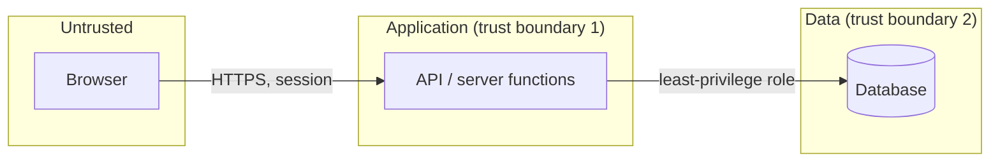

# Threat model: <project>

| | |
|---|---|
| Last updated | <YYYY-MM-DD> |
| Scope | <what is covered; what is explicitly out of scope> |
| Method | STRIDE per trust boundary, with appsec-threat-model |

## System

<Two or three sentences: what the system does and for whom.>

### Assumptions

- A1: <assumption, and what changes if it is wrong>

### Assets

| Asset | Why it matters |
|---|---|
| <personal data of customers> | <harm if read, changed or lost> |
| <money, payment state, balances> | |
| <admin and staff accounts> | |
| <secrets: API keys, signing keys, database credentials> | |
| <developer accounts: code host, cloud, domain, third-party dashboards> | |

### Actors

| Actor | Trust | Can do |
|---|---|---|
| Anonymous visitor | none | |
| Customer | own data only | |
| Admin | full, MFA | |
| <external service> | signed messages only | |
| <AI assistant> | untrusted component | <its tools> |

### Data flows and trust boundaries

| ID | Boundary | What crosses it |
|---|---|---|
| B1 | <browser → API> | <requests, session cookie> |

## Threats

| ID | Boundary | STRIDE | Scenario | Likelihood | Impact | Requirements |
|---|---|---|---|---|---|---|
| T-01 | B1 | Elevation of privilege | <who does what, step by step, and the outcome> | High | High | REQ-01, REQ-02 |

## Decisions to take

| Question | Options | Current assumption |
|---|---|---|
| <decision that is costly to change later> | | |

## Out of scope

- <what was not modelled and why>
